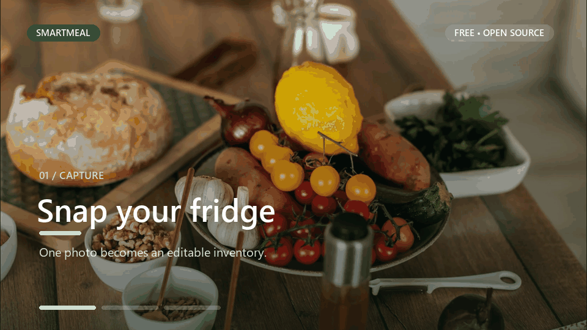
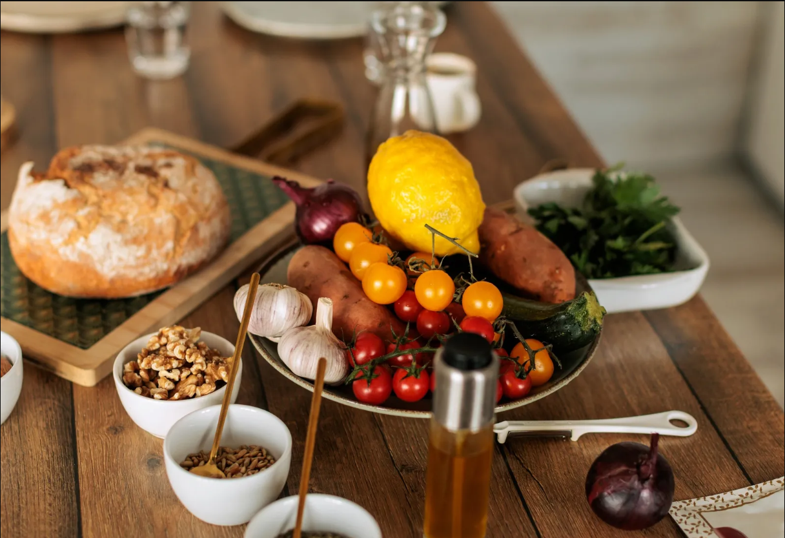

<div align="center">

# SmartMeal

<sub><b>Turn a photo of your fridge into a week of protein-forward meals — with an exact shopping list.</b></sub>

<p>
  
  
  
  
  
  <a href="https://github.com/Ishan-5/SmartMeal/actions/workflows/check.yml"></a>
</p>

<p>
  <a href="#quick-start"><b>Run locally</b></a> ·
  <a href="#the-free-stack"><b>Why it's free</b></a> ·
  <a href="#project-tree"><b>File tree</b></a> ·
  <a href="#deploy"><b>Deploy</b></a> ·
  <a href="https://github.com/Ishan-5/SmartMeal"><b>Star on GitHub</b></a>
</p>



<p><sub>Snap a photo. Edit what you actually own. Cook the plan. Buy only the gaps.</sub></p>

<a href="https://vercel.com/new/clone?repository-url=https%3A%2F%2Fgithub.com%2FIshan-5%2FSmartMeal">
  
</a>

</div>

---

## Why SmartMeal exists

Most meal planners begin with an empty kitchen and a full shopping budget. SmartMeal begins with **the food already in your fridge**, scales it to the people eating, and fills only the missing pieces.

| The 5pm problem | The SmartMeal answer |
| --- | --- |
| “What can I cook with this?” | A vision model reads a fridge or pantry photo into an editable inventory |
| “How much do I actually need?” | Every quantity is scaled by household size and portion setting |
| “I don't want to buy protein again” | Protein-first planning enforces a per-meal minimum and retries if needed |
| “I lost my plan” | Optional accounts save up to 50 plans per user |
| “The AI is down” | Automatic fallback to the local planning engine keeps the flow usable |
| “Free tier or bust” | OpenRouter + Groq + Supabase + Vercel free tiers — no paid mail service |

**No credit card. No sign-up needed to try the full flow.**

---

## The 60-second flow


### What you get

| ✨ | Feature | What it means |
| --- | --- | --- |
| 📸 | **Photo → inventory** | Upload, drop or paste a fridge photo; edit every recognized item |
| 🍽️ | **Household scaling** | People, portions, days and protein focus change the math instantly |
| 🥩 | **Protein-first plans** | Every meal clears a minimum; the planner retries if it slips |
| 🛒 | **Honest shopping list** | Buy quantities subtract what you already have |
| 📺 | **Cook-along links** | Every recipe includes a YouTube link or a search for the dish |
| 💾 | **Saved plans** | Optional account, reopen and delete plans from the workspace |
| 🧪 | **Never a dead end** | Demo recognition and local planning keep the app alive without keys |

### Visual story

<p align="center">
  
  
</p>

<p align="center"><sub>From what is already on the counter to a week that feels handled.</sub></p>

---

## The free stack

| Job | Service | Free-tier choice |
| --- | --- | --- |
| Photo recognition | [OpenRouter](https://openrouter.ai/) | `particle-ai/particle-1:free`, fallback `nvidia/nemotron-3.5-super-vl:free` |
| Weekly planning | [Groq](https://groq.com/) | `openai/gpt-oss-120b` |
| Database and auth storage | [Supabase](https://supabase.com/) | Free Postgres project |
| Hosting | [Vercel](https://vercel.com/) | Hobby plan and free `*.vercel.app` domain |
| Waitlist export | CSV over HTTP | No paid email service |

Gemini is supported as an optional fallback, but some Google Cloud projects have no Gemini free tier and return `403: free tier is not available for this project`. That is why OpenRouter + Groq are the defaults.

---

## Quick start

Requires **Node.js 20.6+** for the optional migration script.

```bash
git clone https://github.com/Ishan-5/SmartMeal.git
cd SmartMeal
npm install
cp .env.example .env.local
npm run dev
```

Open **http://localhost:3000**. With an empty `.env.local` you get demo recognition and local planning stored in `data/db.json`. No external service is required.

| Command | Purpose |
| --- | --- |
| `npm run dev` | Local development server |
| `npm run typecheck` | TypeScript only |
| `npm test` | Vitest unit tests |
| `npm run test:watch` | Watch mode while developing |
| `npm run build` | Production build |
| `npm run check` | Typecheck + tests + production build |
| `npm run db:migrate` | Optional: apply `supabase/schema.sql` from `DATABASE_URL` |

---

## Make it live

<details>
<summary><b>1. Connect the live AI</b> — optional locally, recommended in production</summary>

Create free keys at [OpenRouter](https://openrouter.ai/keys) and [Groq](https://console.groq.com/keys), then add them to `.env.local`:

```env
OPENROUTER_API_KEY=your-key
OPENROUTER_MODEL=particle-ai/particle-1:free
OPENROUTER_FALLBACK_MODEL=nvidia/nemotron-3.5-super-vl:free
GROQ_API_KEY=your-key
GROQ_MODEL=openai/gpt-oss-120b
```

Restart the dev server and visit `http://localhost:3000/api/status`:

```json
{
  "ok": true,
  "ai": {
    "scan": { "provider": "openrouter", "live": true, "model": "particle-ai/particle-1:free" },
    "plan": { "provider": "groq", "live": true, "model": "openai/gpt-oss-120b" }
  },
  "storage": "supabase",
  "waitlistExport": true
}
```

Recognition tries **OpenRouter → Gemini → OpenAI → sample inventory**. Planning tries **Groq → OpenRouter → Gemini → OpenAI → local engine**. Slow or rate-limited providers never break the flow; `AbortSignal` timeouts keep the chain inside the Vercel Hobby limit.

</details>

<details>
<summary><b>2. Add persistent storage</b> — required on Vercel</summary>

Local JSON works on your machine, but Vercel's filesystem is read-only and ephemeral. A deployed product needs Supabase.

1. Create a free project at [database.new](https://database.new).
2. Open **SQL Editor**, paste `supabase/schema.sql`, and run it.
3. In **Project Settings → API**, copy the **Project URL** and **service_role** key. Never use the anon key.
4. Add them to `.env.local`:

```env
SUPABASE_URL=https://your-project.supabase.co
SUPABASE_SERVICE_ROLE_KEY=your-service-role-key
```

5. Restart the server. Accounts, sessions, waitlist entries and saved plans now live in Postgres.

Prefer the CLI? Set `DATABASE_URL` and run `npm run db:migrate`.

</details>

<details>
<summary><b>3. Export the waitlist</b> — no email bill</summary>

```env
ADMIN_TOKEN=a-long-random-string
```

```bash
curl -H "Authorization: Bearer $ADMIN_TOKEN" \
  https://your-app.vercel.app/api/admin/waitlist \
  -o smartmeal-waitlist.csv
```

Import the CSV into any free email tool. Duplicate signups are handled safely and CSV cells are guarded against formula injection.

</details>

<details>
<summary><b id="deploy">4. Deploy on Vercel</b> — free hobby plan</summary>

1. Push the repository to GitHub.
2. In Vercel, choose **Add New → Project** and import `Ishan-5/SmartMeal`, or use the deploy button above.
3. Add these project variables:

```text
APP_URL=https://your-project.vercel.app
OPENROUTER_API_KEY
OPENROUTER_MODEL=particle-ai/particle-1:free
OPENROUTER_FALLBACK_MODEL=nvidia/nemotron-3.5-super-vl:free
GROQ_API_KEY
GROQ_MODEL=openai/gpt-oss-120b
SUPABASE_URL
SUPABASE_SERVICE_ROLE_KEY
ADMIN_TOKEN
```

4. Deploy and use the free `*.vercel.app` URL. A custom domain costs money and is intentionally skipped.

`APP_URL` must be set **before** the build so canonical URLs, Open Graph tags, `robots.txt` and `sitemap.xml` use the production domain. Redeploy after changing it. Do not add `GEMINI_API_KEY` or `DATABASE_URL` to Vercel for this setup.

</details>

---

## Environment reference

Everything is optional locally; Supabase is required in production. See `.env.example` for a copyable template.

| Variable | Purpose |
| --- | --- |
| `APP_URL` | Public URL used for metadata, canonical links and sitemap |
| `OPENROUTER_API_KEY` | Free vision key for photo recognition |
| `OPENROUTER_MODEL` | Vision model; default `particle-ai/particle-1:free` |
| `OPENROUTER_FALLBACK_MODEL` | Backup vision model |
| `GROQ_API_KEY` | Free fast text key for planning |
| `GROQ_MODEL` | Plan model; default `openai/gpt-oss-120b` |
| `AI_SCAN_PROVIDER`, `AI_PLAN_PROVIDER` | Force a provider: `groq`, `openrouter`, `gemini`, `openai`, `demo` |
| `AI_TIMEOUT_MS`, `AI_SCAN_TIMEOUT_MS` | Provider timeouts in milliseconds; defaults `12000` / `18000` |
| `GEMINI_API_KEY` / `GOOGLE_API_KEY` | Optional Gemini fallback |
| `GEMINI_MODEL` | Optional Gemini model override |
| `OPENAI_API_KEY`, `OPENAI_MODEL`, `AI_PROVIDER=openai` | Optional paid fallback; not needed for the free setup |
| `SUPABASE_URL`, `SUPABASE_SERVICE_ROLE_KEY` | Hosted Postgres storage; use the **service_role** key |
| `DATABASE_URL` | Only used by `npm run db:migrate` |
| `DATA_DIR` | Local JSON fallback directory |
| `ADMIN_TOKEN` | Protects the waitlist CSV export |
| `LOG_LEVEL` | Structured log level: `debug`, `info`, `warn` or `error` |
| `NEXT_DIST_DIR` | Internal: allows a production build beside a dev server |

Never commit `.env.local`. `.gitignore` also covers `.env.*.local`.

---

## Product map and API

| Route | Purpose |
| --- | --- |
| `/` | Landing page, product story, FAQ and waitlist |
| `/app` | Full workspace: scan → household → plan → grocery list |
| `/login`, `/signup` | Accounts for saved plans |
| `/privacy`, `/terms` | Honest policies for a product that handles photos and email |
| `/api/status` | Which provider is live for scanning and planning |
| `/api/health` | Real health check: env, database reachability and AI providers |
| `/api/admin/waitlist` | CSV export, protected by `ADMIN_TOKEN` |

<details>
<summary><b>API reference</b></summary>

| Endpoint | Auth | Notes |
| --- | --- | --- |
| `POST /api/scan` | None | `{ image: dataURL, mimeType }`; validates size/type; returns ingredients + mode |
| `POST /api/plan` | None | `{ ingredients, household }`; returns plan, mode and optional note |
| `POST /api/waitlist` | None | `{ email, source }`; duplicate-safe and rate-limited |
| `GET /api/auth/me` | Cookie | Current user or `{ user: null }` |
| `POST /api/auth/signup` | None | Creates account and starts session |
| `POST /api/auth/login` | None | Starts session |
| `POST /api/auth/logout` | Cookie | Ends session |
| `GET /api/account/export` | Cookie | Downloads account data as JSON without password hashes or tokens |
| `DELETE /api/account/delete` | Cookie + password | Deletes the account, plans, sessions and waitlist entry |
| `GET /api/plans` | Cookie | Saved plan summaries |
| `POST /api/plans` | Cookie | Saves a validated plan |
| `GET /api/plans/[id]` | Cookie | Reopens a plan owned by the user |
| `DELETE /api/plans/[id]` | Cookie | Deletes a plan owned by the user |
| `GET /api/status` | None | Provider configuration summary |
| `GET /api/health` | None | Database/provider reachability; `503` when degraded |
| `GET /api/admin/waitlist` | Bearer token | CSV export |

Errors are JSON: `{ "error": "Human-readable message" }`. Rate limits return `429` with `Retry-After`. Browser writes with a foreign `Origin` return `403`.

</details>

---

## Project tree

```text
SmartMeal/
├── src/
│   ├── app/
│   │   ├── api/
│   │   │   ├── account/
│   │   │   │   ├── delete/route.ts        # password-confirmed account deletion
│   │   │   │   └── export/route.ts        # download your account data
│   │   │   ├── admin/waitlist/route.ts    # bearer-protected CSV export
│   │   │   ├── auth/
│   │   │   │   ├── login/route.ts
│   │   │   │   ├── logout/route.ts
│   │   │   │   ├── me/route.ts
│   │   │   │   └── signup/route.ts
│   │   │   ├── plans/
│   │   │   │   ├── [id]/route.ts          # reopen or delete one plan
│   │   │   │   └── route.ts               # list or save plans
│   │   │   ├── health/route.ts
│   │   │   ├── plan/route.ts
│   │   │   ├── scan/route.ts
│   │   │   ├── status/route.ts
│   │   │   └── waitlist/route.ts
│   │   ├── app/                           # scan → household → plan workspace
│   │   │   ├── layout.tsx
│   │   │   └── page.tsx
│   │   ├── login/ + signup/               # auth screens
│   │   ├── privacy/ + terms/              # public legal pages
│   │   ├── error.tsx
│   │   ├── globals.css
│   │   ├── layout.tsx
│   │   ├── loading.tsx
│   │   ├── manifest.ts
│   │   ├── not-found.tsx
│   │   ├── page.tsx                       # landing page
│   │   ├── robots.ts
│   │   └── sitemap.ts
│   ├── components/
│   │   ├── auth-form.tsx
│   │   ├── auth-shell.tsx
│   │   ├── household-step.tsx
│   │   ├── marketing-shell.tsx
│   │   ├── plan-step.tsx
│   │   ├── preview-card.tsx
│   │   ├── saved-plans.tsx
│   │   ├── scan-step.tsx
│   │   ├── site-footer.tsx
│   │   ├── site-header.tsx
│   │   └── waitlist-form.tsx
│   ├── lib/
│   │   ├── account-data.ts                # export payload builder
│   │   ├── ai-output.ts                   # AI response sanitizer
│   │   ├── ai.ts                          # provider chains and prompts
│   │   ├── auth-redirect.ts
│   │   ├── auth.ts                        # hashing and session cookies
│   │   ├── db.ts                          # Supabase adapter + local JSON fallback
│   │   ├── demo-data.ts
│   │   ├── env.ts                         # production config checks
│   │   ├── ingredients.ts                 # pasted-list parser
│   │   ├── logger.ts                      # structured JSON logs
│   │   ├── page-meta.ts
│   │   ├── plan.ts                        # grocery math and aliases
│   │   ├── rate-limit.ts
│   │   ├── security.ts
│   │   ├── supabase.ts
│   │   ├── types.ts
│   │   └── utils.ts
│   ├── instrumentation.ts                 # fail-fast production startup
│   └── middleware.ts                      # request ids
├── tests/                                 # Vitest unit tests
├── supabase/schema.sql                    # users, sessions, waitlist, plans
├── scripts/migrate.mjs                    # optional SQL migration helper
├── docs/smartmeal-demo.gif
├── public/images/                         # hero and product artwork
├── .github/workflows/check.yml            # CI: audit, typecheck, tests, build
├── .env.example
├── next.config.mjs
├── package.json
└── README.md
```

Key starting points: `src/app/page.tsx` for the landing page, `src/app/app/page.tsx` for the workspace, `src/lib/ai.ts` for AI orchestration, and `src/lib/db.ts` for persistence.

<details>
<summary><b>Security and limits</b></summary>

- The Supabase **service_role** key stays server-side and is never prefixed with `NEXT_PUBLIC_`. It bypasses RLS, so every query is scoped by `userId` in server code.
- Session tokens are random 256-bit values; only their SHA-256 digest is stored. Cookies are `httpOnly`, `SameSite=Lax`, secure in production and use the `__Host-` prefix there.
- Production startup fails fast when `APP_URL` or Supabase configuration is missing or invalid, instead of silently using ephemeral local JSON.
- Every request receives an `x-request-id`; logs are structured JSON filtered by `LOG_LEVEL`.
- CI runs a production dependency audit, typecheck, unit tests and a production build on every push and PR.
- Write endpoints reject cross-site browser requests whose `Origin` does not match the app host. Requests without an Origin (curl, server-to-server) still work.
- Rate limits are best-effort and in-memory: 30 scans/plans, 10 signups/waitlist entries and 20 logins per hour per process. They are not a distributed guarantee on serverless.
- External AI calls have `AbortSignal` timeouts and skip the second vision model when the first fails with a fatal 4xx error, so bad keys do not waste the whole chain.
- Photos are resized in the browser and sent to the recognition provider; images are not written to the database. Saved plans store ingredients and settings only.
- OAuth and password reset are intentionally out of scope for this free MVP. Signing in replaces other sessions for that user.
- Signup, login and waitlist are public by design. Add a dedicated WAF or CAPTCHA if you expect abuse.

</details>

<details>
<summary><b>Deliberate scope</b></summary>

- **No custom domain** — the free `*.vercel.app` URL is part of the zero-cost promise.
- **No paid email service** — export a CSV and use any free newsletter tool.
- **No distributed rate limit** — in-process protection is enough for a free hobby deployment; add Redis before scaling out.
- **No image storage** — photos are recognized and discarded, which keeps storage free and privacy simple.

</details>

---

## Deployment checklist

- [ ] Supabase project created and `schema.sql` applied
- [ ] `APP_URL` set to the final `https://*.vercel.app` URL
- [ ] OpenRouter, Groq and Supabase variables added in Vercel
- [ ] `ADMIN_TOKEN` set to a long random string
- [ ] `/api/status` reports `live: true` for both providers
- [ ] `/api/health` returns `200` with `status: "healthy"`
- [ ] `/api/admin/waitlist` returns CSV with the bearer token
- [ ] Signup → save plan → reopen plan tested on the deployed URL
- [ ] `/privacy` and `/terms` reachable from the footer

---

## Troubleshooting

| Symptom | Fix |
| --- | --- |
| `/api/health` returns `503` | Check `environment.errors`, `database.ok` and provider keys in the response |
| `/api/status` says both providers are unavailable | Check key names and restart the dev server or redeploy |
| Production server exits on startup | `APP_URL` or Supabase env is missing/invalid; fix the Vercel variables |
| Scan takes ~60s | The primary vision model is busy; the fallback chain is working. Try again later |
| Plan says “Demo plan” | Groq/OpenRouter quota hit, or no key set; local engine took over |
| Deployed signup/waitlist fails silently | Supabase env missing or `supabase/schema.sql` not applied |
| Canonical URL is localhost | Set `APP_URL` and redeploy |
| Gemini returns `403 free tier not available` | Expected on some Google projects; use OpenRouter + Groq |
| `npm run db:migrate` fails | Use Node 20.6+ and set `DATABASE_URL` |
| Build collides with dev server | `NEXT_DIST_DIR=.next-build npm run build`, then delete `.next-build` |

---

## Contributing

Issues and pull requests are welcome at [github.com/Ishan-5/SmartMeal](https://github.com/Ishan-5/SmartMeal). Keep changes small, run `npm run check` and never commit secrets.

---

<div align="center">

**Snap. Plan. Eat well.**

<sub>Built with free tiers, good defaults and a lot of attention to the 5pm question.</sub>

</div>

<p align="center">
  Built by <b><a href="https://github.com/Ishan-5">Devansh Kumar Pandey (Ishan)</a></b> · <a href="https://linkedin.com/in/devansh584">LinkedIn</a>
</p>

